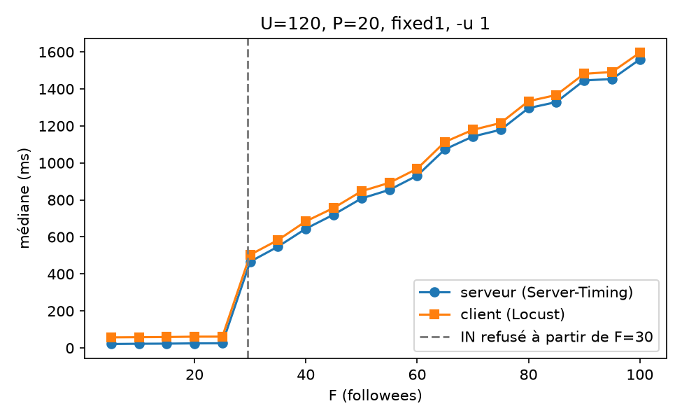
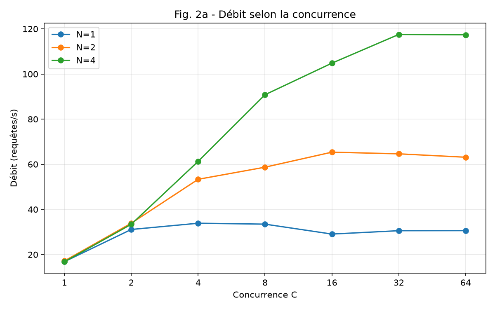
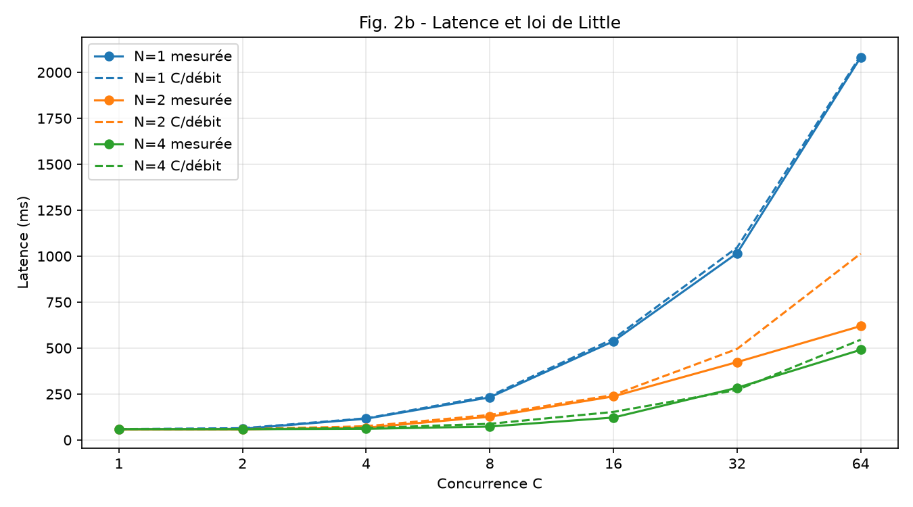
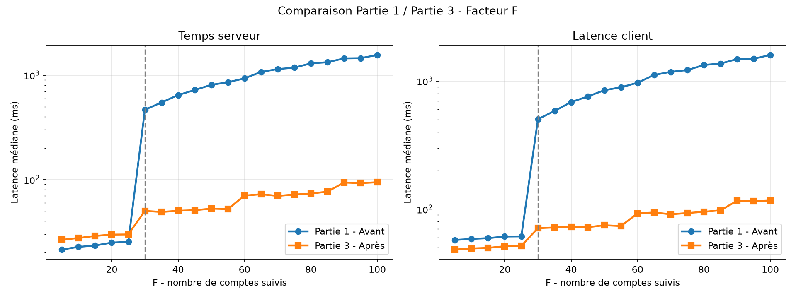
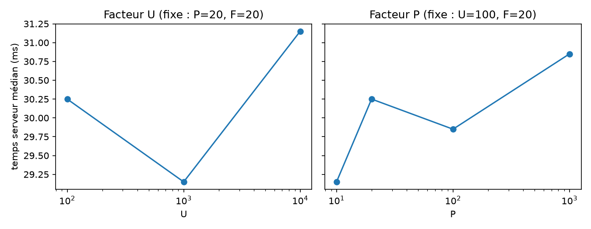
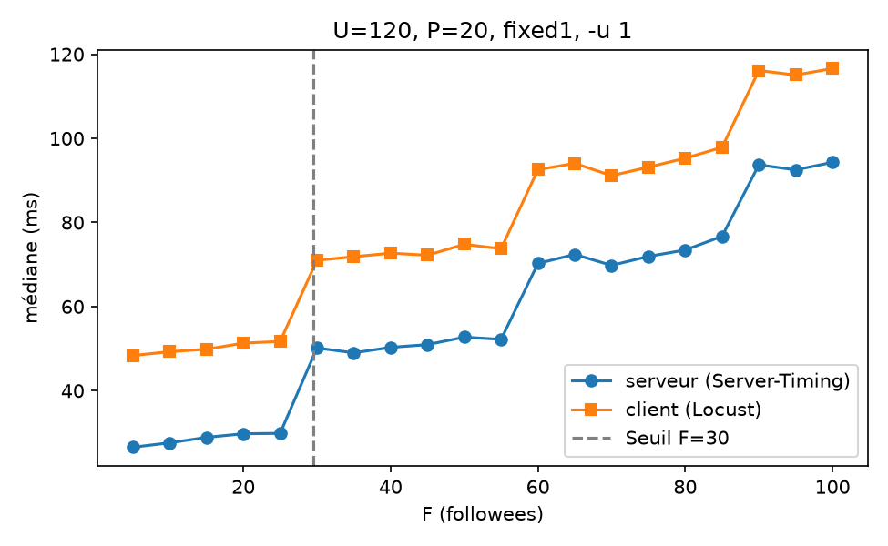
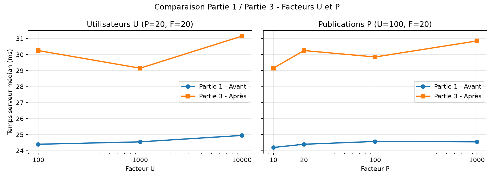

# TinyInsta passe-t-elle à l'échelle ?

**Projet Données massives et cloud — Benchmark 2026**  
**Honorine Tessier — Master 1 Data Science**

Nous évaluons ici le passage à l'échelle de l'application TinyInsta selon deux critères : la stabilité du temps de traitement lorsque le volume de données augmente et la proportionnalité du débit maximal lorsque le nombre d'instances augmente. Enfin, nous corrigeons une limite identifiée puis réexécutons le protocole de mesure.

## 1. Montage

### 1.1. Projet, région, versions et dates

| Élément | Configuration utilisée ou documentée |
|---|---|
| Projet Google Cloud — version initiale | `tiny-insta-510113` |
| Projet Google Cloud — version optimisée | `unified-atom-514316-p4` 
| Région App Engine | europe-west3 |
| Emplacement Datastore | europe-west3 |
| Version par défaut | https://github.com/honorinetessier/projet_tiny_insta |
| Version finale après correction de la partie 3 | https://github.com/honorinetessier/projet-DMC |
| Dates des mesures | **31 octobre 2026** (partie 1), **5 novembre 2026** (partie 2), **16 novembre 2026** (partie 3) |
| D'où tourne le client ? | Locust est exécuté depuis **Google Cloud Shell**  |
| Versions des bibliothèques de mesure | `google-cloud-datastore==2.19.0`, `locust==2.47.0`, `matplotlib==3.11.2`, `pandas==3.0.6` (`raw/env_freeze.txt`) |


### 1.2. Données 

Nous notons **`U`** le nombre d'utilisateurs, **`P`** le nombre exact de posts par utilisateur et **`F`** le nombre exact de comptes suivis par utilisateur. Le jeu de référence est **`U=1 000, P=20, F=20`**.

La base contient les entités `User` (`Nom/ID`, `follows`) et `Post` (`Nom/ID`, `author`, `content`, `created`)

Voici les différents jeux ajoutés à notre Datastore : 

| Jeux | `U` | `P` | `F` |
|---|---:|---:|---:|
| `base` | 1 000 | 20 | 20 |
| `u100`, `u10000` | 100 ; 10 000 | 20 | 20 |
| `p10`, `p100`, `p1000` | 100 | 10 ; 100 ; 1 000 | 20 |
| `f05` à `f100` (pas de 5) | 120 | 20 | 5 à 100 |

Les jeux sont générés avec `bench/seed_exact.py` , par exemple :

```bash
python bench/seed_exact.py --prefix base --users 1000 --posts-per-user 20 --followees 20
```

Les **26 jeux** représentent **394 800 entités** (utilisateurs et publications) lors d'une génération unique.


### 1.3. Protocole 

Pour réaliser nos expériences, nous avons utilisé Locust afin de générer des requêtes vers l'application TinyInsta déployée sur Google App Engine.

Pour chaque configuration étudiée, nous avons effectué **deux répétitions**, les **10 premières secondes** de chaque exécution ont été exclues des calculs pour éviter que la période de démarrage n'influence les mesures.

Nous avons ensuite calculé les temps de réponse médians et les débits obtenus pour chaque configuration. Les résultats présentés correspondent à **la moyenne des médianes des deux répétitions** pour les latences, et à la moyenne des débits pour la partie 2.

Les mesures brutes sont conservées dans le dossier `raw/`, tandis que les données utilisées pour générer les graphiques se trouvent dans `figures/`.


## 2. Résultats des parties 1 à 3

### 2.1. Partie 1 — Coût d'une requête

**Question : de quoi dépend le temps de traitement d'une timeline ?**

#### Hypothèses

- **H1 — Nombre d'utilisateurs (`U`) :** le temps serveur reste plutôt constant, puisque la requête n'explore pas tous les utilisateurs.
- **H2 — Publications par utilisateur (`P`) :** le temps doit rester presque constant grâce à l'index `(author, created DESC)` et à `LIMIT 20`.
- **H3 — Comptes suivis (`F`) :** le temps doit croître avec le nombre d'auteurs interrogés. Si la requête `IN` échoue, le *fallback* qui exécute une requête par auteur devrait coûter plus cher.

#### Protocole et figures

Nous utilisons `fixed1`, **une seule requête concurrente** (`C=1`), et faisons varier un facteur à la fois : `U={100, 1000, 10000}`, `P={10, 100, 1000}` et `F={5, 10, ..., 100}`. Chaque jeu est mesuré deux fois, soit **52 runs**. Leur ordre mélangé est conservé dans `raw/p1_order.txt` et les contrôles de cohérence dans `raw/p1_check.csv`.


*Figure 1a — Temps serveur médian en fonction de `U` (`P=20, F=20`) et de `P` (`U=100, F=20`). Pour tous ces tests : `N=1, C=1`.*

| Facteur | Valeurs testées | Temps serveur médian | Verdict |
|---|---|---:|---|
| `U` | 100 ; 1 000 ; 10 000 | 24,40 à 24,95 ms | Quasi constant |
| `P` | 10 ; 100 ; 1 000 | 24,20 à 24,58 ms | Quasi constant |

Multiplier `U` ou `P` par **100** n'augmente le temps serveur que de **moins de 1 ms**. **H1 et H2 sont confirmées pour les plages mesurées** : l'accès est ciblé par auteur et l'index ordonné évite de parcourir l'ensemble de la base.



*Figure 1b — Temps serveur et latence client médians selon `F` (`U=120, P=20, N=1, C=1`) ; 20 valeurs de `F` entre 5 et 100.*

| `F` | Chemin de code initial | Temps serveur médian | Latence client médiane |
|---:|---|---:|---:|
| 5 | Requête `IN` | 21,40 ms | 57,45 ms |
| 25 | Requête `IN` | 25,40 ms | 61,25 ms |
| 30 | *Fallback* | 466,45 ms | 503,78 ms |
| 50 | *Fallback* | 808,10 ms | 847,10 ms |
| 100 | *Fallback* | 1 559,43 ms | 1 595,60 ms |

Jusqu'à `F=25`, le coût augmente faiblement. Entre **`F=25` et `F=30`**, il passe brutalement de **25,40 à 466,45 ms** (×18,4), puis augmente à peu près linéairement. L'essai `bench/check_in.py` (`raw/check_in_output.txt`) explique cette rupture : une requête Datastore `IN` accepte **au plus 30 valeurs**, alors que notre liste contient `F+1` auteurs. Dès `F=30`, la requête initiale échoue et le code bascule vers une requête séquentielle par auteur, suivie d'un tri Python. **H3 est partiellement confirmée** car nous n'avions pas anticipé aussi grande augmentation a F=30.

#### Surcoût entre temps client et temps serveur

Pour estimer le surcoût entre le temps client et le temps serveur, nous calculons la différence entre les deux mesures :

**Surcoût (ms) = Latence client (ms) − Temps serveur (ms)**

Nous calculons ensuite la proportion de ce surcoût dans la latence totale :

**Part du surcoût (%) = (Surcoût / Latence client) × 100**

Par exemple, pour `F=5` :

- Surcoût : `57,45 − 21,40 = 36,05 ms`
- Part du surcoût : `(36,05 / 57,45) × 100 = 62,75 %`

Pour `F=100` :

- Surcoût : `1 595,60 − 1 559,43 = 36,17 ms`
- Part du surcoût : `(36,17 / 1 595,60) × 100 ≈ 2,27 %`

L'écart observé est donc d'environ **36 ms**, quelle que soit la valeur de `F`. Il représente **62,75 %** de la latence totale à `F=5`, contre seulement **2,27 %** à `F=100`.

Cela montre que lorsque la requête `IN` fonctionne, le surcoût représente une part importante du temps de réponse. En revanche, lorsque le fallback est déclenché, le temps de traitement côté serveur devient largement dominant. Cet écart comprend notamment les échanges réseau, mais peut également inclure d'autres traitements non mesurés par `Server-Timing`.

#### Lectures Datastore et coût théorique d'un million de timelines

La timeline lit l'utilisateur et jusqu'à 20 posts si IN fonctionne : 21 lectures. Avec le fallback initial, elle lit jusqu'à 1 + 20 × (F+1) entités. Le prix de référence utilisé pour notre région (europe-west3) est de 0,039 USD pour 100 000 lectures. Pour estimer le coût d'un million de timelines, nous utilisons la formule suivante :

- `Coût (USD) = (Nombre de lectures par timeline × 1 000 000 / 100 000) × 0,039`

Soit, de manière simplifiée :

- `Coût (USD) = Nombre de lectures par timeline × 10 × 0,039`

Par exemple, pour F=30, le fallback est déclenché et nous obtenons :

Nombre de lectures : `1 + 20 × (30+1) = 621`

Coût pour un million de timelines : `621 × 10 × 0,039 = 242,19 USD` 

| Cas | Lectures estimées / timeline | Coût indicatif / 1 million |
|---|---:|---:|
| `IN`, `F≤29` | 21 | 8,19 USD |
| `F=30`, fallback | 621 | 242,19 USD |
| `F=50`, fallback | 1 021 | 398,19 USD |
| `F=100`, fallback | 2 021 | 788,19 USD |

Le problème n'est donc pas seulement la latence : le fallback augmente aussi fortement le nombre de données lues. À `F=100`, le coût des lectures est environ **96 fois** celui du régime `IN`.


### 2.2. Partie 2 — Capacité et ajout d'instances

**Question : combien de timelines par seconde peut servir une instance, et le débit maximal est-il proportionnel au nombre d'instances ?**

#### Hypothèses

- **H1 :** avec un seul worker Gunicorn synchrone par instance, le débit atteint rapidement un plafond, ensuite la latence augmente davantage que le débit.
- **H2 :** deux puis quatre instances doivent augmenter le débit maximal d'environ ×2 puis ×4. 
- **H3 :** après saturation, la **latence moyenne** doit suivre la loi de Little : `C ≈ débit × latence moyenne`.
- **H4 :** la répartition des requêtes entre instances peut modifier le gain, nous devons donc vérifier les instances réellement sollicitées avec `X-Instance`.

#### Protocole et figures

Nous gardons le jeu de référence **`U=1 000, P=20, F=20`** et faisons varier **`N={1,2,4}`** instances fixes ainsi que la concurrence **`C={1,2,4,8,16,32,64}`**. Chaque combinaison est testée deux fois : **42 runs**. Les versions `fixedN` sont testées successivement. La partie 2 mesure le débit en requêtes par seconde et la latence médiane, en retirant les dix premières secondes.



*Figure 2a — Débit en fonction de la concurrence `C`, pour `N=1,2,4` ; `U=1000, P=20, F=20`.*

| Concurrence `C` | `N=1` (req/s) | `N=2` (req/s) | `N=4` (req/s) |
|---:|---:|---:|---:|
| 1 | 16,8 | 17,2 | 16,8 |
| 2 | 31,1 | 33,9 | 33,4 |
| 4 | 33,9 | 53,3 | 61,3 |
| 8 | 33,5 | 58,7 | 90,8 |
| 16 | 29,1 | 65,4 | 104,8 |
| 32 | 30,6 | 64,6 | 117,5 |
| 64 | 30,6 | 63,1 | 117,4 |


Avec les courbes on remarque un **plateau de saturation**. Pour une instance, le débit atteint environ **30 à 34 req/s** vers `C=4`. Deux instances atteignent environ **63 à 65 req/s** vers `C=16`, et quatre instances environ **117 req/s** vers `C=32`.
Nous observons donc que **plus le nombre d'instances augmente, plus l'application peut supporter d'utilisateurs simultanés avant d'atteindre son débit maximal**.


Pour comprendre pourquoi le débit finit par atteindre une limite, nous avons regardé comment l'application est lancée avec  `gunicorn -b :$PORT main:app` . Comme les options `--workers` et `--threads` ne sont pas précisées, Gunicorn utilise par défaut **un seul worker synchrone par instance**. Cela signifie qu'une instance ne peut traiter qu'une requête à la fois.

Lorsqu'une requête est envoyée, le worker doit notamment attendre les résultats de Datastore avant de pouvoir traiter la suivante. Nous avons également remarqué que le temps de traitement de `get_timeline` reste relativement stable, autour de quelques dizaines de millisecondes, même lorsque la concurrence augmente.

Ainsi, **l'augmentation de la latence vient principalement du fait que les requêtes doivent attendre leur tour**, et non du fait que la fonction `get_timeline` devient plus lente. **L'hypothèse H1 est donc confirmée** : une instance atteint rapidement sa capacité maximale, car elle ne peut traiter qu'une seule requête à la fois.




*Figure 2b — Latence client **médiane** mesurée (trait continu) et prédiction `1000 × C / débit` en millisecondes (pointillés), pour les trois valeurs de `N` ; jeu `base`.*

| `C` | Latence médiane `N=1` | `N=2` | `N=4` |
|---:|---:|---:|---:|
| 1 | 58,5 ms | 57,4 ms | 58,7 ms |
| 4 | 115,8 ms | 67,4 ms | 60,8 ms |
| 16 | 537,3 ms | 237,3 ms | 122,1 ms |
| 32 | 1 015,8 ms | 423,6 ms | 284,0 ms |
| 64 | 2 081,8 ms | 619,8 ms | 490,5 ms |

Après saturation, **ajouter de la concurrence augmente principalement l'attente**. Avec `N=1` et `C=64`, la médiane mesurée vaut **2 081,8 ms** contre **2 091,2 ms** prévus par `C/débit`. Avec `N=2` et `C=64`, la médiane n'est que de **619,8 ms** pour **1 013,9 ms** prédits. Cette variation vient du fait que : **la loi de Little concerne une moyenne, pas une médiane**. Les mesures individuelles donnent environ **995 ms de latence moyenne** pour `N=2, C=64`, ce qui est proche des **1 014 ms** prédits. Pour `N=4, C=64`, la latence moyenne est d'environ **543 ms**, contre **545 ms** prédits. **L'hypothèse H3 est donc confirmée lorsque nous comparons les latences moyennes.**

#### Mise à l'échelle du débit


À concurrence égale et élevée (`C=64`), nous obtenons des débits de **30,6**, **63,1** et **117,4 req/s** pour `N=1`, `N=2` et `N=4`. En passant de 1 à 2 instances, le débit est multiplié par **2,06**, et en passant de 1 à 4 instances, il est multiplié par **3,84**. Nous n'atteignons pas exactement un facteur 4, mais nous en sommes très proches. **L'hypothèse H2 est donc globalement confirmée** : augmenter le nombre d'instances permet d'augmenter presque proportionnellement le débit maximal.

Concernant la répartition des requêtes, les fichiers CSV montrent que **toutes les instances configurées ont bien participé au traitement** : 1 instance pour `N=1`, 2 pour `N=2` et 4 pour `N=4`. À forte concurrence, les requêtes sont globalement bien réparties, avec environ 50 % du trafic par instance pour `N=2` et 25 % pour `N=4`. Nous avons également observé que toutes les instances participaient même à faible concurrence (`C=1`). **L'hypothèse H4 est donc partiellement confirmée** : toutes les instances participent bien au traitement des requêtes, mais elles sont aussi utilisées à faible concurrence, contrairement à ce que nous pensions.


### 2.3. Partie 3 — Correction du fallback et nouvelles mesures

#### Correction apportée et hypothèses


Nous avons choisi de corriger le problème identifié dans la partie 1, car le fallback augmente fortement le temps de traitement et le nombre de lectures Datastore. Pour cela, nous avons modifié la fonction `get_timeline` dans `main.py`. Lorsque le nombre d'auteurs dépasse 30, nous les séparons en plusieurs groupes de 30 auteurs maximum. Pour chaque groupe, nous utilisons une requête `IN` afin de récupérer jusqu'à 20 posts. Nous rassemblons ensuite tous les posts récupérés, nous les trions du plus récent au plus ancien, puis nous gardons uniquement les 20 plus récents pour construire la timeline. Si une requête `IN` échoue, le fallback initial reste disponible pour récupérer les posts individuellement.

La modification conduit à **`arrondit_entier_supérieur((F+1)/30)` requêtes groupées** au lieu de `F+1` requêtes individuelles. Par exemple, pour `F=100`, **4 requêtes** au lieu de **101**.

#### Hypothèses

- **H1 :** forte diminution du temps serveur pour `F≥30` 
- **H2 :** disparition de la rupture à `F=30`, avec éventuellement de petites marches lorsque le nombre de groupes augmente 
- **H3 :** l'augmentation du nombre d'utilisateurs (`U`) ou du nombre de posts par utilisateur (`P`) ne devrait avoir le même impact sur le temps de traitement des timelines qu'en partie 1.

#### Protocole et figures avant/après

La partie 3 **répète la campagne de la partie 1**.



*Figure 3 — Comparaison des performances avant (partie 1) et après optimisation (partie 3) : évolution du temps serveur et de la latence client en fonction du nombre de comptes suivis (`F`). Les mesures sont réalisées avec `U=120`, `P=20`, `N=1` et `C=1`. Chaque point correspond à la moyenne des médianes de deux tests, après exclusion des 10 premières secondes.*



*Figure 3a — Temps serveur après correction pour `U` et `P` ; paramètres fixes identiques à la figure 1a.*



*Figure 3b — Temps serveur et latence client après correction, en fonction de `F` ; `U=120, P=20, N=1, C=1`.*



*Comparaison complémentaire 1a/3a — Avant/après pour `U` et `P`, avec les mêmes paramètres fixés.*

#### Résultats et interprétation

| `F` | Serveur avant | Serveur après | Gain serveur | Client avant | Client après | Gain client |
|---:|---:|---:|---:|---:|---:|---:|
| 25 | 25,40 ms | 29,85 ms | Pas de gain | 61,25 ms | 51,70 ms | ×1,18 |
| 30 | 466,45 ms | 50,15 ms | ×9,30 | 503,78 ms | 71,00 ms | ×7,10 |
| 50 | 808,10 ms | 52,73 ms | ×15,33 | 847,10 ms | 74,80 ms | ×11,32 |
| 60 | 931,40 ms | 70,25 ms | ×13,26 | 968,75 ms | 92,55 ms | ×10,47 |
| 100 | 1 559,43 ms | 94,30 ms | ×16,54 | 1 595,60 ms | 116,60 ms | ×13,68 |

**L'hypothèse H1 est confirmée.** Nous observons une forte diminution des temps de réponse lorsque `F ≥ 30`. Par exemple, pour `F=100`, le temps serveur passe d'environ **1 559 ms à 94 ms**, soit un traitement **16,5 fois plus rapide**. La latence client diminue également, passant d'environ **1 596 ms à 117 ms**, soit un gain de **13,7 fois**.
Nous remarquons cependant que les gains côté client sont différents de ceux côté serveur. Cela peut notamment s'expliquer par le fait que les deux campagnes ont été réalisées à des dates différentes, sur des machines différentes et avec des conditions réseau différentes.

**H2 est confirmée avec une nuance importante.** La rupture à `F=30` est **fortement atténuée, mais pas supprimée**, le temps serveur passe de **29,85 ms à `F=25`** à **50,15 ms à `F=30`**. De nouveaux paliers sont visibles autour de `F=60` et `F=90` : le nombre de groupes passe respectivement de 2 à 3 puis de 3 à 4. Cette forme de courbe correspond bien à notre formule `arrondit_entier_supérieur((F+1)/30)`.


**L'hypothèse H3 est confirmée.** Après notre modification, le temps serveur reste presque constant lorsque nous augmentons le nombre d'utilisateurs (`U`) ou le nombre de posts par utilisateur (`P`). Pour `U=100`, `1 000` et `10 000`, nous obtenons des temps serveur de **30,25 ms**, **29,15 ms** et **31,15 ms**. Pour `P=10`, `20`, `100` et `1 000`, les temps restent entre **29,15 et 30,85 ms**. Ces résultats montrent que **l'augmentation de U ou de P n'a presque pas d'influence sur le temps de traitement**, comme nous l'avions déjà observé dans la partie 1. Nous remarquons cependant que les temps serveur sont légèrement plus élevés qu'en partie 1 pour les petites valeurs de `F`. Cette différence peut venir du fait que les deux campagnes ont été réalisées à des dates et des conditions différentes.


#### Coût et limites de la correction

Notre modification permet également de **réduire le nombre de lectures Datastore** lorsque `F≥30`.

Avant la modification, le nombre de lectures était estimé avec la formule :

**Lectures = 1 + 20 × (F+1)**

Après la modification, nous utilisons la formule :

**Lectures = 1 + 20 × arrondit_entier_supérieur((F+1)/30)**

Par exemple :
- Pour `F=30`, nous passons d'un maximum de **621 à 41 lectures** par timeline.
- Pour `F=100`, nous passons d'un maximum de **2 021 à 81 lectures** par timeline.

En reprenant le tarif utilisé dans la partie 1, le coût théorique d'un million de timelines pour `F=100` passerait donc de **788,19 USD à 31,59 USD**, soit un coût environ **25 fois moins élevé** pour les lectures Datastore.

Cependant, notre modification présente aussi quelques limites. Si une requête groupée échoue, le fallback initial est toujours utilisé pour récupérer les posts individuellement.

**Nous concluons donc que notre modification permet de réduire fortement les temps de traitement et le coût théorique des lectures Datastore.**


## 3. Tableau des verdicts

| Dimension | Passe à l'échelle ? | Jusqu'où ? | Pourquoi (mécanisme) | Preuve |
|---|---|---|---|---|
| **Utilisateurs (`U`)** | **Oui**, dans la plage étudiée | `U=100` à `10 000` | La requête récupère uniquement les informations de l'utilisateur et des comptes qu'il suit, sans avoir besoin de parcourir tous les utilisateurs de la base de données. | Fig. 1a et 3a |
| **Posts par utilisateur (`P`)** | **Oui**, dans la plage étudiée | `P=10` à `1 000` | Index `(author, created DESC)` et limitation aux 20 posts les plus récents. | Fig. 1a et 3a |
| **Followees (`F`)** | **Non avec le code initial après `F=29` , fortement amélioré avec la correction**, mais non constant | Mesuré jusqu'à `F=100` ; seuil initial à `F=30`, puis paliers aux changements de nombre de groupes | Initialement, limite de 30 valeurs `IN` et fallback séquentiel, après correction, requêtes `IN` par groupes de 30, puis fusion. | Fig. 1b, 3b et 3 (comparaison avant/après) |
| **Instances (`N`)** | **Oui, presque proportionnellement** | De 1 à 4 instances (`C≤64`) | Un worker synchrone Gunicorn par instance, ajouter des instances ajoute de la capacité de traitement. | Fig. 2a et 2b |


**Verdict d'ensemble : TinyInsta passe-t-elle à l'échelle ?**

Nos expériences montrent que **TinyInsta passe globalement à l'échelle, mais avec certaines limites**.

Dans la partie 1, nous avons montré que l'augmentation du nombre d'utilisateurs (`U`) ou du nombre de posts par utilisateur (`P`) n'a presque pas d'influence sur le temps de traitement des timelines.
Dans la partie 2, nous avons observé que l'ajout d'instances (`N`) permet d'augmenter presque proportionnellement le débit maximal. En passant de 1 à 4 instances, le débit est multiplié par environ **3,84**.
En revanche, le nombre de comptes suivis (`F`) représente une limite importante. Dans la version initiale, le temps de traitement augmente fortement dès `F=30`, à cause du fallback.
La modification réalisée dans la partie 3 permet de corriger en grande partie ce problème. Par exemple, pour `F=100`, le temps serveur passe d'environ **1 559 ms à 94 ms**, soit un traitement **16,5 fois plus rapide**.

Nous pouvons donc conclure que **TinyInsta passe bien à l'échelle pour le nombre d'utilisateurs, le nombre de posts et le nombre d'instances dans les limites de nos expériences**. Pour le nombre de comptes suivis, notre optimisation améliore fortement les performances, même si le temps de traitement continue d'augmenter avec `F`.


## 4. Validité

### 4.1. Combien d’instances ont réellement servi chacune de vos mesures ? Est-ce celles que nous attendions ?

Pour vérifier le nombre d'instances réellement utilisées pendant nos tests, nous avons utilisé l'en-tête `X-Instance`, qui indique quelle instance a traité chaque requête.

Dans la **partie 1**, les 52 tests ont été réalisés avec une seule instance. Nous retrouvons le même résultat pour les **52 tests conservés de la partie 3**.

Pour la **partie 2**, nous avons effectué 14 tests pour chaque configuration. Les résultats montrent que :
- Avec `N=1`, une seule instance a été utilisée.
- Avec `N=2`, les deux instances ont bien été utilisées.
- Avec `N=4`, les quatre instances ont bien été utilisées.

Ces résultats correspondent donc à ce que nous attendions. Nous avons également remarqué que toutes les instances étaient utilisées même avec une faible concurrence (`C=1`). Cela s'explique par le fait que Locust envoie plusieurs requêtes successives pendant un test, et que celles-ci peuvent être envoyées à différentes instances. Les résultats détaillés sont disponibles dans les fichiers `figures/p1_runs_detail.csv`, `figures/p2_runs_detail.csv` et `figures/p3_runs_detail.csv`.


### 4.2. Nos runs sont-ils indépendants ? L’ordre dans lequel nous avons enchaîné les mesures influence-t-il les résultats ?

Pour chaque configuration, nous avons réalisé **deux tests** afin de limiter l'influence des variations sur les résultats. Dans les parties 1 et 3, nous avons mélangé l'ordre des **52 tests** pour éviter que les changements de performance de Google Cloud au cours du temps n'influencent toujours les mêmes configurations. Donc oui l'odre des mesures peut avoir un impact sur les résultats. Les ordres utilisés sont conservés dans `raw/p1_order.txt` et `raw/p3_order.txt`.
En partie 2, nous avons regroupé les tests selon le nombre d'instances (`N=1`, `N=2` et `N=4`) pour éviter de multiplier les déploiements et limiter les coûts.
De plus, toutes nos expériences utilisent le même projet Google Cloud et la même base Datastore. Les tests sont donc réalisés séparément, mais **ils ne sont pas totalement indépendants**, car ils partagent certaines ressources, notamment Datastore, dont les performances peuvent varier selon la charge au moment des mesures.


### 4.3. Quelle part de la latence est due au réseau ?

Pour estimer la part du réseau dans la latence, nous calculons la différence entre le temps client et le temps serveur : **Surcoût (ms) = `LATENCY_MS − SERVER_MS`** , cependant, cet écart ne correspond pas uniquement au réseau. Il comprend aussi d'autres traitements réalisés par l'application.
Dans la **partie 1**, nous avons observé un surcoût d'environ **36 ms**. Il représente **62,75 %** de la latence totale à `F=5`, contre seulement **2,27 %** à `F=100`. Cette différence s'explique par le fait que le temps serveur devient beaucoup plus important lorsque le fallback est utilisé. 
Dans la **partie 3**, le surcoût est plus faible, autour de **21 à 23 ms** selon `F`. Cela peut s'expliquer par des conditions de mesure différentes entre les deux campagnes, notamment au niveau du réseau.
Nous ne pouvons donc pas déterminer précisément quelle part de la latence correspond uniquement au réseau, car l'écart comprend aussi d'autres traitements. Enfin, dans la **partie 2**, lorsque plusieurs requêtes arrivent en même temps, certaines doivent attendre leur tour avant d'être traitées. Cette attente augmente également la latence mesurée côté client.


### 4.4. Qu’avons-nous compté comme un échec ? Quels codes HTTP avons-nous observés ?

Nous considérons comme un **échec** toute requête qui ne renvoie pas le code HTTP `200` (requête réussie). Nous prenons également en compte les erreurs de connexion, enregistrées avec un statut `0` et un message dans `ERROR`.
Pour nos calculs, nous excluons les **10 premières secondes** de chaque test, mais nous conservons toutes les requêtes dans les fichiers CSV.
Voici les résultats obtenus :

- **Partie 1 :** toutes les requêtes des 52 tests et du test de chauffe ont renvoyé un **code HTTP 200**. Nous n'avons donc observé aucune erreur.

- **Partie 2 :** sur les 42 tests, nous avons enregistré **130 649 réponses HTTP 200** et **133 erreurs de connexion** (statut `0`). Parmi ces erreurs, 92 sont de type `gaierror` et 41 de type `ConnectionRefusedError`. Elles se sont toutes produites pendant les 10 premières secondes des tests. Après avoir retiré cette période, **aucune erreur n'a été conservée dans les résultats utilisés pour les graphiques**.

- **Partie 3 :** les 52 tests retenus et le test de chauffe ont uniquement renvoyé des **codes HTTP 200**. Cependant, un premier essai pour `F=55` a rencontré des problèmes : **741 réponses HTTP 200 et 21 erreurs HTTP 500** (erreurs du serveur). Cet essai a été écarté des résultats et conservé dans `raw/p3_f55_r2_echec.csv`. Nous avons ensuite utilisé une répétition sans erreur, enregistrée dans `p3_f55_r2.csv`.

Nous pouvons donc conclure que **toutes les requêtes utilisées pour nos résultats finaux ont réussi**, même si certaines erreurs ont été rencontrées au cours de la campagne.


### 4.5. Avez-vous vérifié que notre mesure exerce bien le chemin de code que nous croyons ?

Pour vérifier que nos tests utilisent bien les bonnes données et le bon fonctionnement de l'application, nous avons effectué plusieurs vérifications. 
Tout d'abord, le script de génération des données permet de définir précisément le nombre d'utilisateurs (`U`), de posts par utilisateur (`P`) et de comptes suivis (`F`). Les fichiers `raw/p1_check.csv` et `raw/p3_check.csv` montrent également que les timelines retournent bien **20 posts**.
Dans la **partie 1**, nous avons utilisé le script `bench/check_in.py` pour vérifier la limite des requêtes `IN`. Nous avons constaté que Datastore refuse une requête contenant **31 auteurs**. Cela confirme que le fallback initial est déclenché dès `F=30`, puisque nous devons récupérer les posts des 30 comptes suivis et de l'utilisateur lui-même.
Dans la **partie 3**, nous avons repris les mêmes jeux de données avec notre code modifié. Les résultats montrent de petites augmentations du temps de traitement à `F=30`, `F=60` et `F=90`, ce qui correspond aux moments où une requête `IN` supplémentaire devient nécessaire.

Ces vérifications montrent donc que nous avons bien identifié le problème de la version initiale et que notre modification améliore les performances.


### 4.6. Combien notre campagne a-t-elle coûté (lectures, écritures, heures d’instance) ?

D'après les jeux de données générés, nous estimons avoir effectué **394 800 écritures** dans Datastore.
Pour estimer le nombre de lectures, nous avons utilisé les formules présentées dans les parties 1 et 3, en prenant en compte toutes les requêtes réussies (HTTP 200), y compris pendant les périodes de chauffe.

Nous obtenons les résultats suivants :

- **Partie 1 :** environ **2 583 875 lectures**.
- **Partie 2 :** environ **2 758 581 lectures**.
- **Partie 3 :** environ **1 578 469 lectures**.

En partie 3, un test pour `F=55` a été écarté à cause d'erreurs HTTP 500. Il contenait cependant **741 requêtes réussies**, ce qui représente environ **30 381 lectures théoriques supplémentaires**.
Nous avons également estimé le temps d'utilisation des instances à partir des fichiers CSV. En tenant compte du nombre d'instances utilisées pendant chaque test, nous obtenons environ **3,39 heures-instance** au total.


## 5. Coût de la campagne

Pour connaître le coût réel de nos expériences, nous avons consulté les rapports de facturation Google Cloud pour nos deux projets.

Nous avons obtenu les résultats suivants :

| Projet Google Cloud | Coût d'utilisation | Remises | Montant facturé |
|---|---:|---:|---:|
| `tiny-insta` (version initiale) | 2,84 USD | -2,84 USD | 0,00 USD |
| `new-tiny-insta` (version optimisée) | 1,36 USD | -1,36 USD | 0,00 USD |
| **Total** | **4,20 USD** | **-4,20 USD** | **0,00 USD** |

Au total, nos deux projets ont consommé **4,20 USD** de ressources Google Cloud, notamment avec App Engine et Firestore en mode Datastore.

Cependant, grâce aux remises appliquées par Google Cloud, **le montant réellement facturé est de 0,00 USD**.

Notre campagne n'a donc entraîné aucune dépense réelle sur la période consultée, même si les ressources utilisées représentent un coût de 4,20 USD avant remises.


