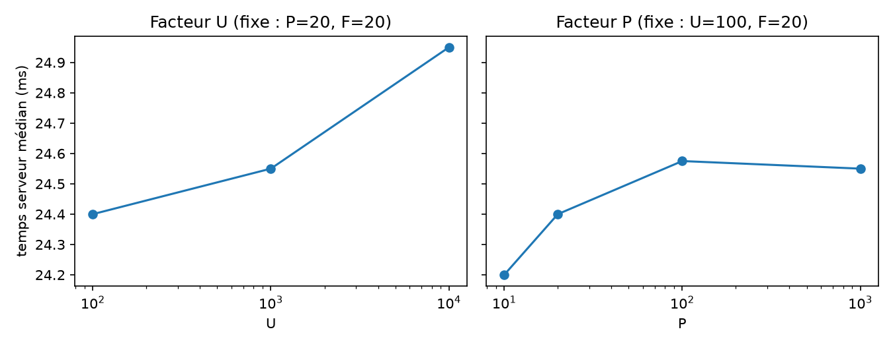

# TinyInsta passe-t-elle à l'échelle ?

**Projet Données massives et cloud **  
**Honorine Tessier - Master 1 DS **

## Introduction


L'objectif de ce projet est de déterminer si TinyInsta passe à l'échelle, et d'expliquer les résultats à partir du code et du fonctionnement de l'infrastructure. Nous étudions deux dimensions :

- **La mise à l'échelle des données :** lorsque le nombre d'utilisateurs, de posts ou de comptes suivis augmente fortement, le temps d'une timeline reste-t-il stable ?
- **La mise à l'échelle des ressources :** lorsque le nombre d'instances App Engine augmente, le débit maximal augmente-t-il dans les mêmes proportions ?

Nous commençons par mesurer le coût d'une timeline (partie 1), puis la capacité de traitement avec plusieurs instances (partie 2). Enfin, nous proposons une correction du principal problème identifié dans la partie 1 et préparons sa réévaluation (partie 3).


## 1. Résultats expérimentaux

### 1.1 Partie 1 — Coût d'une requête

**Question : de quoi dépend le temps de traitement d'une timeline ?**

#### Hypothèses

Avant les mesures, nous formulons les hypothèses suivantes à partir du code :

- **H1 — Influence de `U` :** le temps serveur devrait rester presque constant quand `U` augmente, car une timeline n'interroge pas l'ensemble des utilisateurs, mais uniquement l'utilisateur demandé et les posts des auteurs concernés.
- **H2 — Influence de `P` :** le temps serveur devrait rester presque constant quand `P` augmente. L'index composite trie les posts par auteur et date, et la requête ne renvoie que les 20 plus récents.
- **H3 — Influence de `F` :** le temps serveur devrait augmenter avec `F`, car la requête doit traiter davantage d'auteurs. En cas de passage au fallback, nous anticipons une croissance beaucoup plus importante, puisqu'il faut exécuter une requête par auteur.

#### Protocole

Nous utilisons la version `fixed1` (une instance fixe) et un seul utilisateur Locust à la fois (`C=1`), afin de mesurer les coûts sans saturation par la concurrence. Nous faisons varier séparément `U` entre 100 et 10 000, `P` entre 10 et 1 000 et `F` de 5 à 100 par pas de 5. Nous relevons le temps serveur et la latence client. Les 26 jeux de données font chacun l'objet de deux runs, soit **52 runs** au total. L'ordre des runs est conservé dans `raw/p1_order.txt`.

#### Résultats : influence de `U` et `P`



*Figure 1a — Temps serveur médian d'une timeline lorsque le nombre d'utilisateurs ou le nombre de posts par utilisateur varie. `F=20` ; les autres paramètres sont fixés selon les jeux du protocole.*

| Facteur | Valeurs comparées | Temps serveur médian observé | Interprétation |
|---|---|---|---|
| `U` | 100, 1 000, 10 000 | 24,4 à 24,95 ms | Quasi constant |
| `P` | 10, 100, 1 000 | 24,2 à 24,58 ms | Quasi constant |

Lorsque `U` est multiplié par 100, le temps serveur varie de moins d'une milliseconde. Il en va de même lorsque `P` est multiplié par 100. Ces différences sont faibles et compatibles avec les fluctuations normales des mesures. **H1 et H2 sont donc confirmées dans les plages testées.**

Ce résultat s'explique par le fonctionnement de la requête : la recherche est restreinte aux auteurs suivis, puis l'index permet d'accéder aux posts les plus récents sans parcourir tous les posts de la base. La limite de 20 résultats empêche donc le coût d'augmenter proportionnellement au nombre total de données.

#### Résultats : influence de `F`


*Figure 1b — Temps serveur médian et latence client médiane en fonction du nombre de comptes suivis `F`, de 5 à 100. `U=120`, `P=20`, `N=1`, `C=1`.*

| `F` | Mode utilisé | Temps serveur médian | Latence client médiane |
|---:|---|---:|---:|
| 5 | Requête `IN` | 21,4 ms | 57,45 ms |
| 25 | Requête `IN` | 25,4 ms | 61,25 ms |
| 30 | Fallback | 466,45 ms | 503,78 ms |
| 50 | Fallback | 808,10 ms | 847,10 ms |
| 100 | Fallback | 1 559,43 ms | 1 595,60 ms |

De `F=5` à `F=25`, le temps serveur augmente légèrement, de 21,4 à 25,4 ms. En revanche, nous observons une **rupture nette entre `F=25` et `F=30`** : le temps passe de 25,4 à 466,45 ms, soit plus de 18 fois plus. Au-delà, il augmente presque linéairement avec `F`, pour atteindre environ 1,56 seconde à `F=100`.

Pour comprendre cette rupture, nous avons testé directement la requête `IN` avec `bench/check_in.py`. Le test montre que Datastore accepte au maximum **30 valeurs dans la liste `IN`**. Or, notre timeline contient les `F` comptes suivis **plus l'utilisateur lui-même**, soit `F+1` auteurs. La requête fonctionne donc jusqu'à `F=29`, puis échoue dès `F=30` avec une erreur `InvalidArgument: 400` concernant les 31 valeurs fournies.

Dans le code initial, cette erreur est interceptée et déclenche le fallback. Celui-ci lance successivement `F+1` requêtes sur les posts, récupère jusqu'à 20 résultats par requête, puis effectue un tri en Python : **le programme change de stratégie à `F=30`**.

**H3 est confirmée**, mais nous n'avions pas anticipé l'emplacement exact de la rupture, qui dépend de la limite des requêtes `IN` imposée par Datastore.

#### Latence client et surcoût hors `get_timeline`

La latence client inclut le temps de traitement de la timeline, mais aussi les échanges réseau et les traitements HTTP non comptés par l'en-tête `Server-Timing`. Nous calculons donc l'écart :

`écart = latence client médiane - temps serveur médian`

| `F` | Écart client − serveur | Part de la latence client |
|---:|---:|---:|
| 5 | 36,05 ms | 62,75 % |
| 25 | 35,85 ms | 58,53 % |
| 30 | 37,33 ms | 7,41 % |
| 100 | 36,18 ms | 2,27 % |

L'écart est relativement stable, autour de 36 à 40 ms, malgré les changements de `F`. Lorsque la requête `IN` fonctionne, ce surcoût représente environ 60 % de la latence client. Avec le fallback, le temps passé à traiter la timeline devient dominant et la part de cet écart descend sous 8 %.

Nous ne pouvons toutefois pas attribuer tout cet écart au seul réseau : il inclut également des traitements du serveur qui ne sont pas mesurés dans `get_timeline` (construction de la réponse JSON, framework HTTP, etc.). La mesure donne donc un ordre de grandeur du surcoût extérieur à la fonction, et non une mesure isolée du temps réseau.

#### Lectures Datastore et coût d'un million de timelines

Dans le cas favorable, une timeline lit approximativement une entité `User` et 20 entités `Post`, soit **21 lectures d'entités**. Dans le fallback, elle lit approximativement une fiche utilisateur et jusqu'à 20 posts pour chacun des `F+1` auteurs :

```text
Requête IN :             lectures ≈ 1 + 20 = 21
Fallback (F ≥ 30) :      lectures ≈ 1 + 20 × (F + 1)
```

Avec la valeur de tarification trouvé sur le site de google store : (**0,039 USD pour 100 000 unités de lecture**), et sans appliquer les quotas gratuits, on obtient les estimations suivantes :

| Cas | Lectures estimées par timeline | Coût estimé pour 1 million de timelines |
|---|---:|---:|
| `F ≤ 29` (requête `IN`) | 21 | 8,19 USD |
| `F = 30` (fallback) | 621 | 242,19 USD |
| `F = 50` (fallback) | 1 021 | 398,19 USD |
| `F = 100` (fallback) | 2 021 | 788,19 USD |

Entre `F=25` et `F=30`, le nombre de lectures estimées passe de 21 à 621.

**Conclusion de la partie 1.** TinyInsta passe à l'échelle lorsque `U` ou `P` augmente dans les plages étudiées. En revanche, elle ne passe pas à l'échelle lorsque `F` dépasse la limite de la requête `IN` : le fallback entraîne une forte hausse de la latence et du nombre de lectures Datastore.

### 1.2 Partie 2 — Capacité 

**Question : combien de timelines par seconde une instance peut-elle servir ? Le débit maximal est-il proportionnel au nombre d'instances ?**

#### Hypothèses

- **H1 — Une instance atteint rapidement sa capacité maximale :** comme Gunicorn est lancé sans option `--workers` ni `--threads`, sa configuration par défaut comporte un worker synchrone par instance. Une instance devrait donc saturer rapidement et son débit devrait plafonner.
- **H2 — Augmenter le nombre d'instances augemnte proportionnellement de débit maximal :** avec deux ou quatre instances, le débit maximal devrait être environ deux ou quatre fois plus élevé, sauf si une ressource partagée limite les performances.
- **H3 — Loi de Little :** lorsque le débit est saturé, augmenter le nombre d'utilisateurs simultanés doit surtout augmenter la latence moyenne, conformément à la relation `C ≈ débit × latence moyenne` en boucle fermée.
- **H4 — La répartition des requêtes entre les instances influence la capacité observée :** le nombre d'instances configurées ne garantit pas qu'elles participent toutes au traitement des requêtes pendant une mesure, ce qui pourrait expliquer une capacité inférieure à celle attendue.

#### Protocole

Nous utilisons uniquement le jeu de référence `base` (`U=1000`, `P=20`, `F=20`). Nous déployons successivement `fixed1`, `fixed2` et `fixed4`, et faisons varier la concurrence `C` parmi **1, 2, 4, 8, 16, 32 et 64** utilisateurs Locust. Chaque combinaison `(N,C)` est répétée deux fois, soit **42 runs**. Les 10 premières secondes de chaque run sont exclues de l'analyse. La capacité est évaluée à partir du débit en requêtes par seconde ; l'en-tête `X-Instance` permet de vérifier le nombre d'instances qui ont réellement servi des requêtes.

#### Résultats : débit et saturation


*Figure 2a — Débit moyen en requêtes/s selon la concurrence `C` pour `N=1`, `2` et `4` instances ; jeu `base` (`U=1000`, `P=20`, `F=20`).*

| Concurrence `C` | Débit `N=1` (req/s) | Débit `N=2` (req/s) | Débit `N=4` (req/s) |
|---:|---:|---:|---:|
| 1 | 16,8 | 17,2 | 16,8 |
| 2 | 31,1 | 33,9 | 33,4 |
| 4 | 33,9 | 53,3 | 61,3 |
| 8 | 33,5 | 58,7 | 90,8 |
| 16 | 29,1 | 65,4 | 104,8 |
| 32 | 30,6 | 64,6 | 117,5 |
| 64 | 30,6 | 63,1 | 117,4 |

Avec **une instance**, le débit augmente de 16,8 req/s à `C=1` à 33,9 req/s à `C=4`, puis ne progresse pratiquement plus. Sa capacité est donc de l'ordre de **30 à 34 timelines par seconde** dans la configuration testée. Avec **deux instances**, le débit se stabilise autour de 63 à 65 req/s à partir de `C≈16`. Avec **quatre instances**, il atteint environ 117 req/s vers `C≈32`, puis plafonne.

| Nombre d'instances | Saturation observée vers `C` | Meilleur débit moyen observé |
|---:|---:|---:|
| 1 | 4 | 33,9 req/s |
| 2 | 16 | 65,4 req/s |
| 4 | 32 | 117,5 req/s |

La saturation s'explique principalement par l'exécution synchrone des requêtes. Chaque instance possède un worker Gunicorn qui attend notamment les réponses de Datastore. Tant que ce worker est occupé, les autres requêtes doivent patienter. L'ajout d'utilisateurs Locust augmente alors la file d'attente sans améliorer le débit. Le temps médian mesuré dans `get_timeline` reste proche de 20 à 24 ms même en forte concurrence, ce qui indique que la hausse de latence est surtout liée à l'attente **avant** le traitement de la timeline.

**H1 est confirmée** : une instance atteint rapidement son plafond de capacité.

#### Résultats : latence et loi de Little


*Figure 2b — Latence client médiane selon `C` pour les trois valeurs de `N`, comparée à la prédiction `1000 × C / débit` (ms). Jeu `base`.*

| Concurrence `C` | Latence médiane `N=1` | Latence médiane `N=2` | Latence médiane `N=4` |
|---:|---:|---:|---:|
| 1 | 58,5 ms | 57,4 ms | 58,7 ms |
| 2 | 60,8 ms | 57,7 ms | 58,7 ms |
| 4 | 115,8 ms | 67,4 ms | 60,8 ms |
| 8 | 232,0 ms | 126,6 ms | 73,3 ms |
| 16 | 537,3 ms | 237,3 ms | 122,1 ms |
| 32 | 1 015,8 ms | 423,6 ms | 284,0 ms |
| 64 | 2 081,8 ms | 619,8 ms | 490,5 ms |

Pour `N=1`, la latence médiane augmente très fortement après `C=4`, alors que le débit reste proche de 30 à 34 req/s. À `C=64`, elle dépasse deux secondes. Pour `N=4`, elle n'est que d'environ 490 ms au même niveau de concurrence : répartir la charge réduit donc nettement l'attente.

La loi de Little, appliquée à un système stable avec une charge en boucle fermée et un temps de réflexion nul, s'écrit :

```text
C ≈ débit × latence moyenne (en secondes)
latence moyenne prédite (ms) ≈ 1000 × C / débit (req/s)
```

Les courbes de la figure 2b suivent globalement la même tendance, mais la comparaison n'est pas strictement équivalente : **la loi de Little porte sur la moyenne, alors que la figure présente des médianes**. À `N=2, C=64`, la prédiction vaut environ 1 014 ms et la médiane mesurée seulement 620 ms. En revanche, le calcul effectué sur les requêtes individuelles donne une **latence moyenne d'environ 995 ms**, beaucoup plus proche de la prédiction. À `N=4, C=64`, nous obtenons environ 543 ms en moyenne pour 545 ms prédits.

**H3 est donc confirmée pour la latence moyenne** : au-delà de la saturation, la croissance de la concurrence se traduit principalement par une augmentation du temps d'attente.

#### Gain apporté par plusieurs instances

Pour comparer les configurations dans le même régime de forte concurrence, nous utilisons les débits à `C=64` :

| Instances `N` | Débit à `C=64` | Gain par rapport à `N=1` |
|---:|---:|---:|
| 1 | 30,6 req/s | × 1,00 |
| 2 | 63,1 req/s | × 2,06 |
| 4 | 117,4 req/s | × 3,84 |

Le passage de une à quatre instances multiplie donc le débit par environ **3,84**, soit une efficacité de mise à l'échelle d'environ `3,84 / 4 = 96 %` à `C=64`. Nous sommes proches du facteur 4 attendu. Si nous comparons les **meilleurs** débits observés à des concurrences différentes, le gain est plus faible : `117,5 / 33,9 ≈ 3,47`. Ces deux comparaisons n'utilisent pas la même référence et ne doivent pas être confondues.

Nous avons également examiné les instances réellement observées. Pour `N=2` et `C=64`, chacune traite environ 46 à 54 % des requêtes réussies. Pour `N=4` et `C=64`, les parts sont comprises entre environ 23 et 27 %. Les instances prévues participent donc toutes au traitement et la répartition est relativement équilibrée. Même à `C=1`, plusieurs instances apparaissent au cours d'un run : les requêtes sont successives et peuvent être routées vers des instances différentes.

**H2 est globalement confirmée et H4 est partiellement confirmée.** L'ajout d'instances augmente presque proportionnellement le débit, et les instances sont bien utilisées. En revanche, notre supposition initiale selon laquelle certaines instances pourraient ne pas participer à faible concurrence n'est pas observée.

**Conclusion de la partie 2.** Une instance traite environ 30 à 34 timelines par seconde sur le jeu de référence. Le serveur Gunicorn synchrone limite la capacité de chaque instance, mais l'ajout d'instances permet de traiter davantage de requêtes en parallèle. Dans les conditions testées, TinyInsta **passe presque linéairement à l'échelle avec les ressources**.

### 1.3 Partie 3 — Corriger le fallback et re-mesurer

#### Problème choisi

Les deux premières parties ont mis en évidence deux limites : le basculement vers le fallback dès `F=30` et la saturation du worker Gunicorn. Nous avons choisi de corriger **le premier problème**, car il augmente à la fois le temps serveur et le nombre de lectures Datastore nécessaires à une timeline.

Dans le code initial, une timeline avec `F=100` implique 101 requêtes individuelles sur les posts en cas de fallback. Notre objectif est de diminuer ce nombre sans changer le résultat fonctionnel de l'API.

#### Modification du code

Dans la version corrigée de `main.py`, lorsque la liste des auteurs contient plus de 30 noms, nous la découpons en groupes de **30 auteurs au maximum**. Pour chaque groupe, nous lançons une requête `IN` ordonnée par date décroissante, avec une limite de 20 posts. Nous fusionnons ensuite les résultats, les trions en Python et conservons les 20 plus récents. Un fallback par auteur demeure prévu si la requête `IN` échoue pour un groupe.

Le nombre de requêtes groupées prévues devient :

```text
Nombre de requêtes IN ≈ plafond((F + 1) / 30)
Exemple pour F = 100 : plafond(101 / 30) = 4 requêtes groupées
```

Cette méthode est correcte pour sélectionner les 20 publications globalement les plus récentes : un post qui n'apparaît pas parmi les 20 plus récents de **son propre groupe** ne peut pas appartenir aux 20 plus récents de l'ensemble. Il suffit donc de récupérer au plus 20 posts par groupe avant la fusion finale. Pour `F≤29`, la nouvelle branche n'est pas empruntée et le comportement initial est conservé.

#### Hypothèses avant les nouvelles mesures

- **H1 — Diminution du temps serveur pour `F≥30` :** réduire le nombre de requêtes Datastore devrait fortement diminuer la latence. À `F=100`, nous passons théoriquement de 101 requêtes individuelles à 4 requêtes groupées.
- **H2 — Atténuation de la rupture à `F=30` :** la transition entre 25 et 30 comptes suivis ne devrait plus provoquer le même saut de latence., de petits paliers pourront apparaître lorsqu'un groupe supplémentaire devient nécessaire.
- **H3 — Pas de dégradation pour `U` et `P` :** la limite de 20 posts et le chemin utilisé lorsque `F=20` ne changent pas. Nous nous attendons donc à retrouver des temps presque constants lorsque `U` ou `P` augmente.

#### Protocole de validation et de comparaison

Afin de comparer correctement la version initiale et la version corrigée, nous devons reprendre **exactement le protocole de variation de `F` de la partie 1** : une seule instance fixe, `C=1`, `U=120`, `P=20`, 20 valeurs de `F` entre 5 et 100, deux répétitions par valeur et exclusion des 10 premières secondes de chaque run. La version corrigée doit être déployée séparément avec `--no-promote`, sans remplacer la version par défaut. L'index `Post(author, created DESC)` doit être opérationnel avant les mesures.

Nous comparerons le temps serveur médian, la latence client médiane, les codes de réponse, le nombre d'instances observées et la validité des timelines retournées (20 posts correctement ordonnés). Les résultats avant/après devront être tracés sur une même **figure 3** et sauvegardés dans `figures/fig3.csv` et `figures/fig3.png`.

<!-- À activer lorsque la figure et son CSV auront été générés :

-->

| `F` | Temps serveur avant correction | Temps serveur après correction | Gain |
|---:|---:|---:|---:|
| 25 | 25,4 ms | **À mesurer** | **À calculer** |
| 30 | 466,45 ms | **À mesurer** | **À calculer** |
| 50 | 808,10 ms | **À mesurer** | **À calculer** |
| 100 | 1 559,43 ms | **À mesurer** | **À calculer** |

Sur le plan théorique, les requêtes groupées renvoient au maximum `20 × plafond((F+1)/30)` posts, au lieu de jusqu'à `20 × (F+1)` dans le fallback initial. Ce changement devrait donc réduire les lectures d'entités et leur coût. Il augmente en revanche la complexité du code, nécessite une fusion des résultats et conserve une dépendance aux limitations et aux index de Datastore. **Le gain réel, les éventuels échecs et l'absence de régression devront être établis avec les nouveaux CSV, sans être déduits de la seule modification du code.**

**État de la partie 3 :** correction implémentée et hypothèses formulées ; aucune conclusion expérimentale après correction n'est encore possible tant que les nouvelles mesures ne sont pas disponibles.

## 3. Tableau des verdicts

| Dimension | Passe à l'échelle ? | Jusqu'où ? | Pourquoi (mécanisme) | Preuve |
|---|---|---|---|---|
| Utilisateurs `U` | **Oui, dans la plage testée** | De 100 à 10 000 utilisateurs | La timeline cible un utilisateur et un ensemble restreint d'auteurs ; elle ne parcourt pas tous les utilisateurs. | Fig. 1a |
| Posts par utilisateur `P` | **Oui, dans la plage testée** | De 10 à 1 000 posts par utilisateur | Index composite et limitation aux 20 publications les plus récentes. | Fig. 1a |
| Comptes suivis `F` | **Oui jusqu'à 29, non au-delà avec le code initial** | Requête `IN` jusqu'à 29 followees ; fallback dès 30 | Limite de 30 valeurs dans `IN`, suivie d'une requête séquentielle par auteur et d'un tri en Python. La correction est à re-mesurer. | Fig. 1b ; Fig. 3 à venir |
| Instances `N` | **Oui, presque linéairement** | De 1 à 4 instances, dans les conditions testées | Un worker synchrone par instance ; ajouter des instances ajoute des capacités de traitement indépendantes. Gain ×3,84 à `C=64`. | Fig. 2a et 2b |

La réponse à la question « TinyInsta passe-t-elle à l'échelle ? » est donc **nuancée** : la volumétrie des utilisateurs et des posts ne dégrade presque pas le temps d'une timeline, et la capacité augmente avec le nombre d'instances. En revanche, le nombre de comptes suivis révèle une rupture importante dans l'implémentation initiale.

## 4. Validité des expériences

### 4.1 Instances réellement utilisées

Nous n'avons pas supposé qu'une version `fixedN` faisait participer toutes ses instances : nous avons utilisé l'en-tête `X-Instance` enregistré pour chaque requête. Dans les CSV de synthèse, toutes les configurations de la partie 1 utilisent une instance. Dans la partie 2, les mesures font apparaître respectivement 1, 2 et 4 instances pour les versions `fixed1`, `fixed2` et `fixed4`, y compris dans les runs à faible concurrence. Les répartitions constatées à `C=64` sont relativement équilibrées.

Le nombre d'instances distinctes observées sur la durée d'un run ne signifie toutefois pas que toutes traitent simultanément des requêtes à chaque instant ; cela mesure leur participation effective au trafic.

### 4.2 Indépendance et ordre des runs

Chaque configuration a été testée deux fois et les premières secondes sont écartées pour réduire l'effet du démarrage. La partie 1 conserve un ordre de passage aléatoire des 52 runs dans `raw/p1_order.txt`, ce qui limite les biais liés à une dérive de la plateforme pendant la campagne. Les jeux de données sont séparés par préfixes.

Les répétitions ne sont pas parfaitement indépendantes : elles partagent le même projet GCP, la même base, l'index et des ressources cloud susceptibles de varier. De plus, la partie 2 enchaîne des campagnes par nombre d'instances pour limiter les coûts, et l'ordre des déploiements pourrait jouer. Les deux répétitions permettent d'observer une variabilité, mais ne constituent pas un intervalle de confiance statistique complet.

### 4.3 Influence du réseau

Avec une seule requête à la fois en partie 1, l'écart entre la latence client et le temps de `get_timeline` est généralement de l'ordre de 36 à 40 ms. Il représente environ 60 % du temps total lorsque la requête `IN` est rapide, puis seulement quelques pourcents en régime fallback. Cet écart inclut le réseau et les traitements HTTP hors de `get_timeline` ; il ne permet pas de quantifier isolément le réseau. En partie 2, la mise en attente des requêtes en concurrence explique une part supplémentaire de la latence client.

### 4.4 Définition et observation des échecs

Nous considérons comme un échec toute requête sans réponse HTTP correcte : code différent de `200` (notamment `4xx`, `5xx`), timeout ou erreur réseau (`STATUS=0`). Les scripts de synthèse filtrent les requêtes de statut `200` après les 10 secondes de chauffe et comptent séparément les erreurs.

Les journaux de la partie 1 contiennent uniquement des réponses `200` pour les requêtes enregistrées. Dans les journaux complets de la partie 2, nous trouvons **133 événements `STATUS=0`**, liés à des erreurs `ConnectionRefusedError` pendant les premières secondes des runs. Ils sont tous exclus par le filtre de chauffe : **aucun échec n'est observé dans les fenêtres retenues pour les 42 mesures**. Il ne faut donc pas affirmer qu'aucune erreur n'a jamais eu lieu pendant la campagne ; il faut préciser que les mesures exploitées ne contiennent pas d'erreurs.

### 4.5 Vérification du chemin de code testé

Avant d'interpréter la figure 1b, nous avons vérifié explicitement le comportement de la requête `IN` avec `bench/check_in.py` et le fichier `raw/check_in_output.txt`. Le seuil de 30 valeurs explique pourquoi le fallback est emprunté à partir de `F=30`. Les jeux de données et leurs comptes rendus de vérification sont conservés dans `raw/`. Les points représentés utilisent une timeline de 20 publications, hors cas de tests spécifiques.

Pour la partie 3, nous devrons vérifier que les groupes ne dépassent jamais 30 auteurs, que la branche optimisée est effectivement exécutée pour `F≥30`, que la timeline reste correcte et que l'index requis est disponible. **Ces vérifications après déploiement ne sont pas encore documentées par des résultats de charge.**

### 4.6 Limites générales

Nos conclusions concernent la configuration testée : App Engine `F1`, Gunicorn avec son paramétrage actuel, Datastore, un client de charge Locust et des tailles de jeux imposées. Nous n'avons pas exploré des millions d'utilisateurs, d'autres classes d'instances ou une charge externe indépendante du temps de réponse. Le client Locust est supposé ne pas constituer un goulot ; cette hypothèse n'a pas fait l'objet d'une mesure séparée de la charge de Cloud Shell. Enfin, le temps `Server-Timing` mesure seulement `get_timeline`, et non l'ensemble du temps d'occupation du worker.

## 5. Coût de la campagne

### 5.1 Écritures et lectures estimées

La préparation initiale de l'ensemble des jeux représente **394 800 créations d'entités** (`User` et `Post`) selon les dimensions prévues. Cette quantité n'inclut pas d'éventuelles purges, recréations ou opérations administratives supplémentaires.

Nous pouvons également estimer les lectures d'entités effectuées par les requêtes réussies enregistrées dans les journaux, **y compris celles des phases de chauffe**, car elles peuvent elles aussi être facturées. Pour cela, nous appliquons le modèle de la partie 1 : 21 lectures pour une timeline utilisant `IN`, ou `1 + 20 × (F + 1)` pour une timeline utilisant le fallback. Pour la partie 2, le jeu `base` utilise `F=20`, soit 21 lectures estimées par requête réussie.

| Poste | Quantité estimée | Méthode |
|---|---:|---|
| Écritures de préparation | 394 800 entités | Somme des tailles des jeux générés |
| Lectures des requêtes de la partie 1 | ≈ 2 583 875 unités | Requêtes `200` des CSV de la partie 1, y compris le run de chauffe, pondérées par `F` |
| Lectures des requêtes de la partie 2 | ≈ 2 758 581 unités | Requêtes `200` des CSV de la partie 2, y compris les runs de chauffe, × 21 |
| **Total des lectures estimées, parties 1 et 2** | **≈ 5 342 456 unités** | Modèle de lectures d'entités |

Au tarif indicatif utilisé dans nos notes (`0,039 USD / 100 000 unités`), cela correspondrait à **environ 2,08 USD de lectures**, *avant prise en compte des quotas gratuits et des éventuelles particularités de facturation*. Cette estimation n'est pas un montant réellement facturé : elle ne prend pas en compte les autres lectures ou opérations éventuelles (génération, contrôles, indexation, consultations manuelles), ni les détails de facturation de Datastore.

### 5.2 Temps d'instance et facture réelle

La somme des durées couvertes par les journaux de tests, multipliées par leur nombre d'instances fixes, représente environ **2,5 heures-instance** pour les parties 1 et 2, en comptant les fichiers de chauffe enregistrés. Il s'agit d'un **minimum correspondant aux fenêtres de tests**, pas du temps total facturé : les instances en *manual scaling* peuvent rester en fonctionnement pendant les déploiements, les vérifications, les pauses et les opérations de maintenance jusqu'à leur arrêt.

Le coût final de la campagne doit aussi intégrer les écritures, les opérations Datastore, les heures d'instances fixes et les futures mesures de la partie 3. Le montant de la console GCP n'est pas présent dans les fichiers analysés et ne peut pas être déduit exactement des journaux de Locust.

**À compléter avec la facture GCP :**

| Poste facturé | Montant constaté |
|---|---|
| App Engine / heures d'instance | **[À renseigner depuis GCP]** |
| Datastore / lectures et écritures | **[À renseigner depuis GCP]** |
| Autres éventuels postes | **[À renseigner depuis GCP]** |
| **Total réel de la campagne** | **[À renseigner depuis GCP]** |

Nous avons cherché à limiter le coût en arrêtant les versions fixes après les tests et en conservant les journaux bruts pour éviter de relancer inutilement des expériences coûteuses.

## Conclusion générale

Les expériences montrent que TinyInsta ne possède pas une réponse unique à la question du passage à l'échelle.

Du point de vue des **données**, le temps d'une timeline reste pratiquement constant quand le nombre d'utilisateurs ou de posts par utilisateur augmente de deux ordres de grandeur. En revanche, augmenter le nombre de comptes suivis au-delà de 29 provoque, dans le code initial, un changement de stratégie de requête. Le fallback effectue une requête par auteur et fait fortement augmenter la latence et les lectures Datastore.

Du point de vue des **ressources**, une instance atteint rapidement un plafond de l'ordre de 30 à 34 timelines par seconde. Ajouter des instances permet de repousser ce plafond : à forte concurrence, quatre instances atteignent un débit environ 3,84 fois supérieur à celui d'une instance. La hausse des latences après saturation est cohérente avec la loi de Little et avec le fonctionnement synchrone du serveur Gunicorn.

La correction proposée en partie 3 consiste à remplacer les nombreuses requêtes individuelles du fallback par des requêtes `IN` groupées. Elle devrait réduire le nombre de requêtes Datastore lorsque `F≥30`, mais **seule une nouvelle campagne réalisée dans les mêmes conditions que la partie 1 permettra de chiffrer le gain réel et de conclure sur son efficacité**.

---

### Fichiers de preuve et commandes utiles

- **Sujet :** `SUJET.md`.
- **Code :** `main.py`, `app.yaml`, `index.yaml`, `deploy_fixed.sh`.
- **Génération et mesure :** `bench/seed_exact.py`, `bench/locustfile.py`, `bench/run_part1.py`, `bench/run_part2.py`.
- **Journaux :** `raw/p1_*.csv`, `raw/p2_*.csv`, `raw/check_in_output.txt`, `raw/env_freeze.txt`, `raw/p1_order.txt`.
- **Figures et données agrégées :** `figures/fig1a.png`, `figures/fig1b.png`, `figures/fig2a.png`, `figures/fig2b.png` et leurs CSV correspondants.

```bash
# Regénérer les figures actuellement disponibles
python bench/analyze_part1.py && python bench/analyze_part2.py
```

*La figure 3 et sa commande de régénération seront ajoutées à l'issue des mesures de la version corrigée.*
